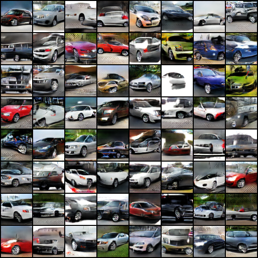
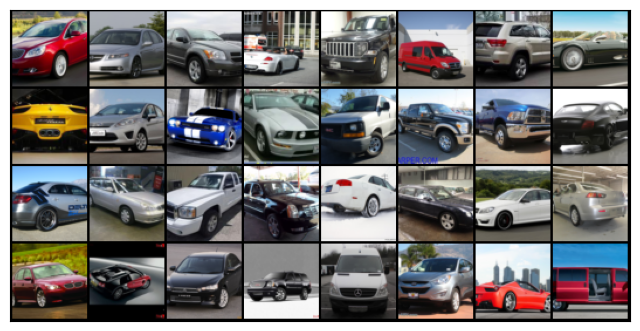
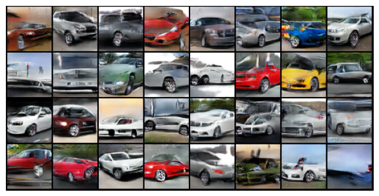
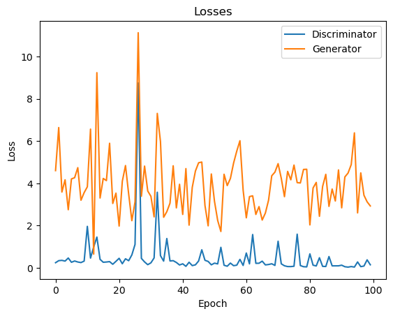
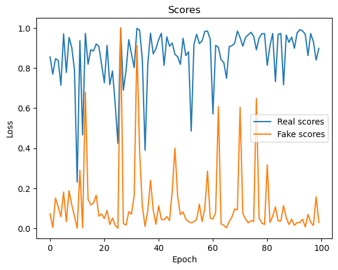

<p align="center">
  
</p>

<h1 align="center">Car-GAN</h1>

<p align="center">
  A Deep Convolutional GAN (DCGAN) that generates 64×64 images of cars, trained on the
  <a href="https://www.kaggle.com/datasets/jessicali9530/stanford-cars-dataset">Stanford Cars dataset</a>.
</p>

<p align="center">
  
</p>

---

## Contents

- [Features](#features)
- [Project structure](#project-structure)
- [Installation](#installation)
- [Quick start: generate cars](#quick-start-generate-cars)
- [Training](#training)
- [Using the notebook](#using-the-notebook)
- [Python API](#python-api)
- [Results](#results)
- [Testing](#testing)
- [Documentation](#documentation)
- [License](#license)
- [Acknowledgements](#acknowledgements)

## Features

- **Pretrained weights** — a generator and discriminator trained for 100 epochs are included in `checkpoints/`, so you can sample cars right away.
- **Installable package** — the model, data pipeline and training loop live in `src/car_gan/`, importable from scripts or notebooks.
- **Command-line interface** — `car-gan train`, `car-gan generate` and `car-gan video`.
- **Runs anywhere** — picks CUDA, Apple Silicon (MPS) or CPU automatically; GPU-trained checkpoints load on CPU.
- **Training timelapse** — every epoch saves a sample grid from a fixed latent batch, which can be turned into a video.

## Project structure

```
Car-GAN/
├── src/car_gan/            # Python package
│   ├── config.py           # Hyperparameters and paths (Config dataclass)
│   ├── data.py             # Kaggle download, transforms, DataLoader
│   ├── models.py           # Generator, Discriminator, DCGAN weight init
│   ├── trainer.py          # GANTrainer training loop and loss plotting
│   ├── utils.py            # Device selection, image grids, checkpoint I/O, video export
│   └── cli.py              # `car-gan` command-line entry point
├── notebooks/car-gan.ipynb # Step-by-step walkthrough of training and sampling
├── checkpoints/            # Pretrained 100-epoch weights (generator.pth, discriminator.pth)
├── assets/gans_training.avi# Timelapse of the original 100-epoch training run
├── docs/                   # Architecture and training guides, images
├── tests/                  # Pytest suite (runs on CPU in seconds)
├── pyproject.toml          # Package metadata and dependencies
└── requirements.txt
```

Created at runtime and ignored by git: `data/` (dataset), `generated-images/` (per-epoch samples).

## Installation

Requires **Python 3.10+**.

```bash
git clone https://github.com/HilthonTT/Car-GAN.git
cd Car-GAN

python -m venv .venv
source .venv/bin/activate        # Windows: .venv\Scripts\activate

pip install -e ".[all]"
```

> **GPU users:** install the CUDA build of PyTorch *first* by following
> [pytorch.org/get-started](https://pytorch.org/get-started/locally/), then run the command above.

The extras are optional: `data` (Kaggle download), `video` (OpenCV), `notebook` (Jupyter) and `dev` (pytest).
`pip install -e .` installs only what is needed to train and generate.

## Quick start: generate cars

No dataset or GPU needed — this uses the pretrained checkpoint:

```bash
car-gan generate --output samples.png --num 64 --seed 42
```

| Option | Default | Description |
| --- | --- | --- |
| `--checkpoint` | `checkpoints/generator.pth` | Generator weights to load |
| `--output` | `samples.png` | Where to save the image grid |
| `--num` | `64` | Number of cars to generate |
| `--nrow` | `8` | Images per row in the grid |
| `--seed` | random | Fix for reproducible output |
| `--device` | auto | `cuda`, `mps` or `cpu` |

`python -m car_gan ...` works the same as `car-gan ...`.

## Training

### 1. Get a Kaggle API token

The dataset is downloaded from Kaggle. Create a token at
[kaggle.com/settings](https://www.kaggle.com/settings) → *API* → *Create New Token*, and either place the
downloaded `kaggle.json` in the repository root or set `KAGGLE_USERNAME` and `KAGGLE_KEY`.
`kaggle.json` is git-ignored.

### 2. Train

```bash
car-gan train --download --epochs 100
```

`--download` is only needed the first time (~1.8 GB). Each epoch prints average losses and scores and saves
`generated-images/epoch-XXXX.png`. Checkpoints are written to `checkpoints/` every 10 epochs and at the end,
along with `history.json` containing the per-epoch metrics.

> ⚠️ Training writes to `checkpoints/` by default and will overwrite the pretrained weights.
> Use `--checkpoint-dir runs/my-run` to keep them.

| Option | Default | Description |
| --- | --- | --- |
| `--epochs` | `100` | Number of epochs |
| `--batch-size` | `128` | Images per batch |
| `--lr` | `0.0002` | Adam learning rate (both networks, β = 0.5, 0.999) |
| `--num-workers` | `2` | DataLoader worker processes |
| `--checkpoint-every` | `10` | Save checkpoints every N epochs |
| `--checkpoint-dir` | `checkpoints` | Where to save weights |
| `--sample-dir` | `generated-images` | Where to save per-epoch sample grids |
| `--data-dir` | `data` | Where the dataset is stored |
| `--resume` | off | Continue from the weights in `--checkpoint-dir` |
| `--start-epoch` | `1` | First epoch number (use with `--resume`, e.g. `101`) |
| `--seed` | none | Random seed |
| `--device` | auto | `cuda`, `mps` or `cpu` |

### 3. Make a timelapse

```bash
car-gan video --image-dir generated-images --output gans_training.avi --fps 4
```

See [docs/training.md](docs/training.md) for tips on reading the metrics and dealing with unstable training.

## Using the notebook

```bash
jupyter notebook notebooks/car-gan.ipynb
```

The notebook walks through downloading the data, inspecting a batch, building the networks, training,
plotting the curves, creating the timelapse and sampling from the pretrained checkpoint.

## Python API

```python
import torch
from car_gan import load_generator
from car_gan.utils import sample_latent, save_samples, show_images

generator = load_generator("checkpoints/generator.pth", device="cpu")
latent = sample_latent(16, generator.latent_size)

save_samples(generator, latent, "cars.png", nrow=4)   # save a grid to disk

with torch.no_grad():
    show_images(generator(latent))                     # or display it with matplotlib
```

Training from Python:

```python
from car_gan import Config, Discriminator, Generator, get_default_device, init_weights
from car_gan.data import build_dataloader
from car_gan.trainer import GANTrainer, plot_history

config = Config(epochs=25, checkpoint_dir="runs/experiment-1")
generator, discriminator = Generator(), Discriminator()
generator.apply(init_weights)
discriminator.apply(init_weights)

trainer = GANTrainer(generator, discriminator, config, get_default_device())
history = trainer.fit(build_dataloader(config))
plot_history(history)
```

## Results

Real training images (left) and samples from the generator after 100 epochs (right):

<p align="center">
  
  
</p>

Losses and discriminator scores over the original 100-epoch run (values from the last batch of each epoch):

<p align="center">
  
  
</p>

A timelapse of the whole run is in [`assets/gans_training.avi`](assets/gans_training.avi).

## Testing

```bash
pytest
```

The suite checks network shapes, that the published checkpoints load, a full training epoch on a tiny
synthetic dataset, and the CLI. It runs on CPU in a few seconds.

## Documentation

- [Architecture](docs/architecture.md) — layer-by-layer description of both networks and the loss
- [Training guide](docs/training.md) — data pipeline, hyperparameters, reading the metrics, troubleshooting
- [Changelog](CHANGELOG.md) — what changed in the refactor

## License

Released under the MIT License. See [LICENSE](LICENSE).

## Acknowledgements

- Dataset: [Stanford Cars](https://www.kaggle.com/datasets/jessicali9530/stanford-cars-dataset) — J. Krause, M. Stark, J. Deng and L. Fei-Fei, *3D Object Representations for Fine-Grained Categorization*, 4th IEEE Workshop on 3D Representation and Recognition, ICCV 2013.
- I. Goodfellow et al., [*Generative Adversarial Networks*](https://arxiv.org/abs/1406.2661), 2014.
- A. Radford, L. Metz and S. Chintala, [*Unsupervised Representation Learning with Deep Convolutional Generative Adversarial Networks*](https://arxiv.org/abs/1511.06434), 2015.
